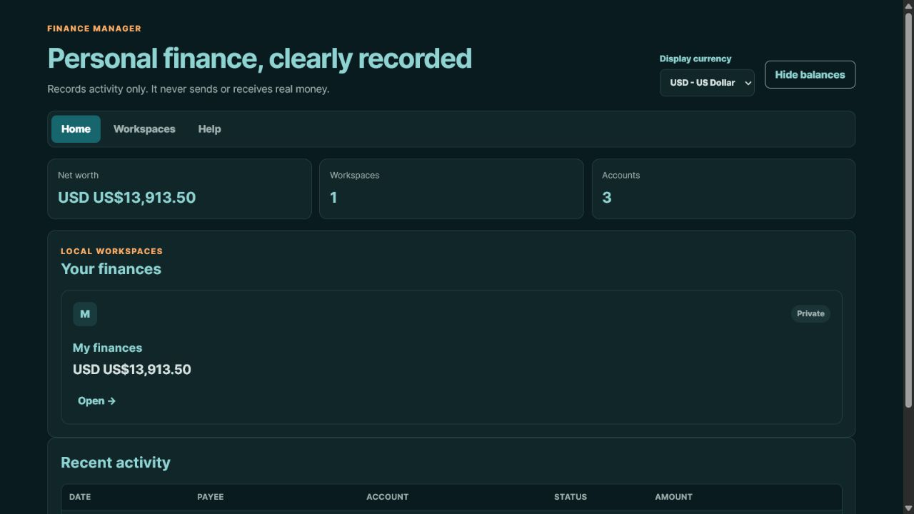
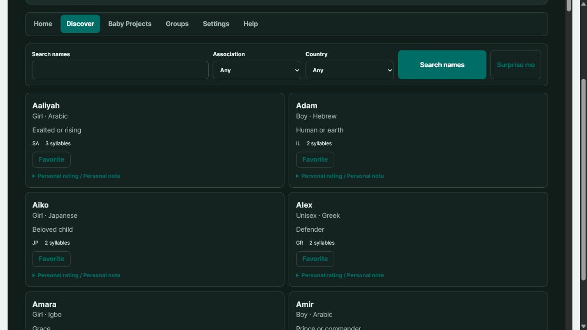
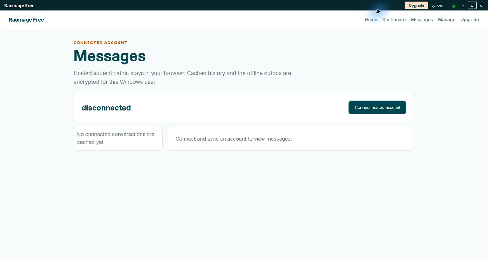
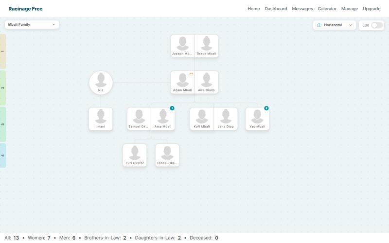
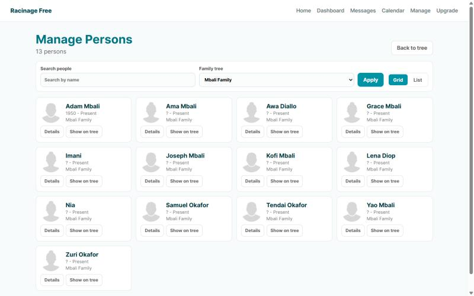

# Racinage Free

Racinage Free is the open-source Windows portable edition of Racinage for the Lite Free plan. It runs locally on one Windows device and stores family data under `%LOCALAPPDATA%\Racinage Free`. The optional Plugins tab connects only to the signed public Racinage plugin catalog and hosted purchase pages; it does not connect the local family database to the hosted Racinage database.

The source tree is now `v0.18.0`. It adds an offline family tree ported from hosted Racinage, and includes an optional local AI assistant for Ollama, LM Studio, and custom OpenAI-compatible loopback servers, plus opt-in connected messaging for a hosted Racinage account. `v0.18.0` is published on GitHub as an unsigned executable, so Windows SmartScreen may warn about an unknown publisher until trusted Windows signing is configured.











## Download

- Latest release: [`RacinageFree-v0.18.0.exe`](https://github.com/Fallax-Vision/racinage_free/releases/download/racinage-free-v0.18.0/RacinageFree-v0.18.0.exe) (unsigned)
- Version: `racinage-free-v0.18.0`
- SHA-256: `e23300f03382139c5d43684943a69369257b53e82ebf61c9e8a9f47bc1f8c761` (also in the release's `checksums.txt`)

## What Is Included

- Borderless native C# WinForms/WebView2 host with one custom app bar.
- Local loopback server and embedded SQLite storage.
- Hosted-style Manage sections without collaboration controls.
- Offline family tree with the hosted Racinage tree front end: up to 2 trees, horizontal and vertical views, pan and zoom, print preview, parents, spouses, partners and children, birth positions, main couple and partner changes, hide, life status, profile photos, a private photo and video gallery, statistics, important dates, and Temporary and Permanent Partial Trees with signed export, copy and paste. Manage Persons lists everyone in the local family with search, grid and list views, read-only details, Show on tree and Add to tree. People from the earlier flat list are migrated unplaced and can be added from there. See `desktop/RacinageFree/tree/VENDORED.md`.
- Private offline Progress analytics with local levels, weekly consistency, badges, and optional static interface accents. See [Progress in Racinage Free](docs/progress.md).
- Optional hosted messaging connection through browser-based device authorization. Password and two-factor authentication are entered only on `racinage.com`.
- Windows DPAPI-protected hosted tokens, an encrypted local message cache, an encrypted ordered offline outbox, resumable file uploads, event-stream recovery, and explicit reconnect conflict reporting.
- First-class Ollama, LM Studio, and custom local OpenAI-compatible setup, model discovery, capability testing, streaming chat, and typed local change previews.
- Strict loopback-only AI endpoints with no cloud fallback. Optional local provider tokens are protected for the current Windows user with DPAPI.
- Preinstalled Finance Manager with offline workspaces, accounts, transactions, budgets, goals, debts, investments, forecasts, reports, circles, imports, exports, and private attachments.
- Installable completely free NameGen companion for parents, with a bundled offline name finder, custom names, favorites, personal ratings and notes, private groups, solo baby projects, and JSON import/export.
- User display currency and manually maintained offline currency rates.
- Bundled Inter variable fonts for consistent offline typography.
- Signed online catalog for reviewed local-compatible plugins, including monthly/yearly pricing and active hosted reductions, with checksum and archive-path verification.
- Sandboxed portable plugin pages with an asynchronous manifest-authorized local bridge and hosted links for optional Pro purchases and entitlements.
- Local Share with Racinage receipts for URI and text payloads, with actions discovered only from signed, installed plugin contracts and a paste/clipboard fallback when Windows package identity is unavailable.
- Kitchen Planner source imports queue traditional structured-data and semantic-page extraction before optional loopback AI. Racinage Free never consumes hosted AI credits.
- Single-file bootstrap executable with payload refresh.
- Racinage icon, screenshot, build script, release manifest, and checksums.

This repository intentionally does not include the hosted Racinage PHP/MySQL web app, production credentials, private uploads, or paid-plan server features.

## Build From Source

Requirements:

- Windows 10 or newer.
- .NET Framework C# compiler, usually available at `C:\Windows\Microsoft.NET\Framework64\v4.0.30319\csc.exe`.
- NuGet packages in the standard global package folder:
  - `Microsoft.Web.WebView2` `1.0.4022.49`
  - `SQLitePCLRaw.lib.e_sqlite3` `2.1.6`

Build:

```powershell
powershell -ExecutionPolicy Bypass -File desktop\RacinageFree\build\build-racinage-free.ps1 -Development
```

Output:

```text
desktop\RacinageFree\dist\development\RacinageFree-v0.18.0-dev.exe
```

Tree checks (golden markup against the hosted PHP renderer, the local tree endpoints, the SQLite migration and a 600-person tree):

```powershell
powershell -ExecutionPolicy Bypass -File desktop\RacinageFree\tests\family-tree\run-family-tree-checks.ps1
```

Development builds are intentionally unsigned and are not release artifacts. Signed public builds require the protected `RACINAGE_WINDOWS_SIGNTOOL` plus a signing certificate path or thumbprint; the build verifies signatures on both the native host and bootstrapper. Until that is configured, the owner publishes the verified development build as an unsigned GitHub release asset.

## Local Data

Racinage Free keeps mutable data outside the executable:

```text
%LOCALAPPDATA%\Racinage Free\data
%LOCALAPPDATA%\Racinage Free\media
%LOCALAPPDATA%\Racinage Free\logs
%LOCALAPPDATA%\Racinage Free\webview
%LOCALAPPDATA%\Racinage Free\plugins
%LOCALAPPDATA%\Racinage Free\plugin-cache
%LOCALAPPDATA%\Racinage Free\ai
%LOCALAPPDATA%\Racinage Free\connected
```

Refreshing or rebuilding the same version preserves local data. Portable AI and Progress never synchronize or expose the local SQLite database to hosted Racinage. Connected messaging synchronizes only the hosted conversations and files authorized for the connected account; it never uploads the local family database.

## Repository

Public repo: <https://github.com/Fallax-Vision/racinage_free>

Hosted Racinage and paid-plan features live at <https://racinage.com>.
